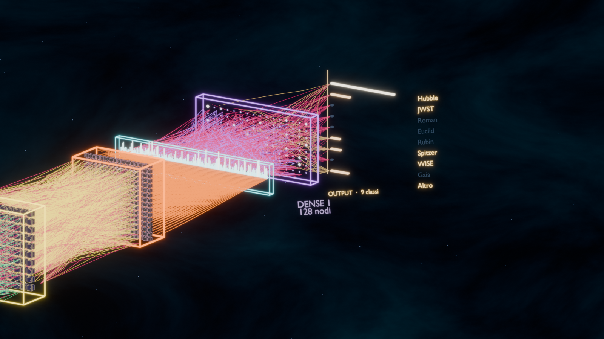

# Models



Questa cartella contiene i due file del modello e il report di valutazione.
La mappa completa della rete, con i pesi e le didascalie dei layer, è la
visualizzazione 3D in [`../Visuals/`](../Visuals/README.md).

## La rete in numeri

| Misura | Valore |
|---|---|
| Input | 1 canale, 64 × 64 = **4.096 pixel** |
| Blocchi convoluzionali | **4** (32 → 64 → 128 → 256 filtri) |
| Ogni blocco | Conv 3×3 + BatchNorm + ReLU + MaxPool 2×2 |
| Nodi dopo i blocchi | 32.768 → 16.384 → 8.192 → 4.096 |
| GAP + Dense 1 + uscite | 256 + 128 + 9 logits |
| Neuroni totali (escluso l'input) | **61.833** |
| Attivazioni totali (incluso l'input) | **65.929** |
| Parametri | **422.857** = 421.280 pesi + 1.577 bias/BatchNorm |
| Dimensione | circa **1,70 MB** |
| Campo recettivo finale | **46 px** su 64 (72% del crop) |
| Parametri in Conv 4 | **69,9%** del totale |

I **nodi** sono le attivazioni: crescono e poi calano con i pooling. I
**pesi** sono molti meno dei nodi perché ogni filtro 3×3 viene riusato su
tutti i pixel: per esempio Conv 1 ha 32.768 nodi ma solo 288 pesi di
convoluzione. La parte densa non è la parte grande del modello: Dense 1 è il
7,8%, Dense 2 lo 0,3%.

Il campo recettivo passa da 4 px dopo il primo pooling a 46 px dopo il
quarto: è il motivo per cui la rete può vedere insieme il nucleo e i bracci
di diffrazione di una stella, non solo un pixel alla volta.

## I due file del modello

| File | Ruolo | Dimensione |
|---|---|---|
| `astro_net_v2_best.pt` | PyTorch checkpoint — fallback su non-Apple, o se CoreML è assente/stantio | ~1,7 MB |
| `AstroNetV2.mlpackage` | CoreML export — motore primario su Apple Silicon, `CPU_AND_NE` | ~1,7 MB |

`evaluation_report.txt` è l’ultimo report sul test set. Il vecchio
checkpoint `_last.pt` e il modello in `quarantine/` sono in `Trash/models/`
per revisione manuale, non usati dall’app.

## La mappa della rete

La scena 3D viene ricostruita dai pesi reali e da un crop Hubble:

```bash
.venv/bin/python Visuals/build_network_data.py
/Applications/Blender.app/Contents/MacOS/Blender \
  -b --factory-startup --python Visuals/blender_build.py
```

La build scrive `Visuals/satai_network_3d.blend`, il poster
`satai_network_3d_wide.png` e il dettaglio testa. Per il video e per i comandi
di render: [`Visuals/README.md`](../Visuals/README.md).

## Rigenerare il pacchetto CoreML

Dopo un training o la sostituzione del checkpoint:

```bash
.venv/bin/python Tools/convert_to_coreml.py --force
```

Il convertitore verifica il risultato su crop reali: stampa la differenza
massima dei logits e l’accordo argmax, ed esce con codice non-zero se non
sono equivalenti. L’app usa PyTorch come fallback quando il `.pt` è più
nuovo del `.mlpackage` (export stantio), quindi rilancia sempre il
convertitore dopo un training.
