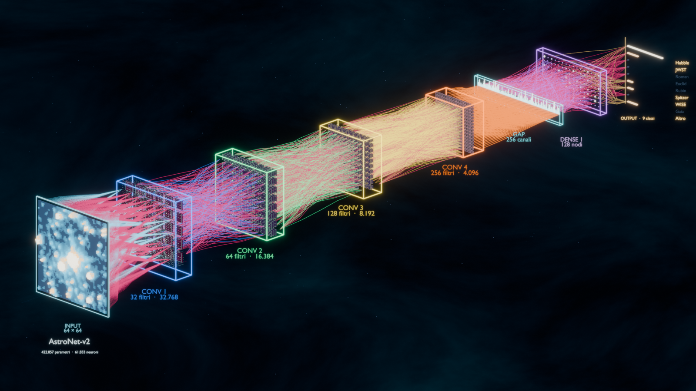

# AstroNet-v2 in 3D

Visualizzazione scientifica della rete **AstroNet-v2**, costruita dai pesi reali
del checkpoint e da un crop reale di Hubble (64×64, predizione **Hubble 99,91%**).
La scena non è una ricostruzione a mano: filtri, kernel, attivazioni e
connessioni vengono estratti dal modello addestrato.



Apri **[`index.html`](index.html)** per vedere il video già renderizzato senza
Blender. Il video è l'animazione della scena Blender, non una scena WebGL
diversa. Dall'app SatAi si apre con il bottone **◈ Visual**, in una finestra
separata a sinistra; la pagina è compattata perché il video sia visibile già
all'apertura, con i capitoli sopra il player.

## Cosa c'è dentro

| File | Cosa è |
|---|---|
| `build_network_data.py` | estrae dal checkpoint input, filtri, kernel 3×3, attivazioni e connessioni reali in `network_data.json` |
| `network_data.json` | dati congelati usati dalla scena (pesi, attivazioni, crop, metadati) |
| `blender_build.py` | costruisce la scena Blender 5.2 (voxel, filtri, fibre, testa, camera, luci, animazione, compositor) e scrive `.blend`, poster largo e dettaglio testa |
| `satai_network_3d.blend` | scena completa, apribile e modificabile in Blender |
| `renders/` | output temporaneo del render (216 PNG, ~295 MB), eliminato dopo l'encoding; rigenerabile e non versionato |
| `satai_network_3d.mp4` | video H.264 dell'animazione, 9 s a 1600×900 / 24 fps |
| `satai_network_3d_wide.png` | poster con la rete intera e tutte le didascalie |
| `satai_network_3d_head.png` | dettaglio finale della testa e delle 9 classi |
| `index.html` | viewer locale compatto, capitoli sopra il video e link ai file |

## Cosa è reale e cosa è una scelta visiva

* **Input**: il crop Hubble reale, 64×64 pixel. Ogni pixel è un voxel colorato
  dalla sua intensità e emette un filamento verso Conv 1: **4.096 filamenti**.
  Anche i pixel scuri mantengono un corpo blu scuro e un'altezza minima: la
  griglia non ha buchi e i cubi quasi a contatto riempiono il volume.
* **Filtri**: 32 + 64 + 128 + 256 = **480 filtri**. Ogni filtro è una pila di
  tre lastre (i tre canali d'ingresso); ogni lastra mostra la sua griglia 3×3
  con i nove pesi reali del kernel. I corpi sono scuri e colorati in modo
  complementare alla cornice neon del layer.
* **Attivazioni**: **61.833** ottaedri post-ReLU, con dimensione e luminosità
  proporzionali al valore reale.
* **Fibre**: **9.872** curve con spessore `|peso|` e colore per layer; **4.724
  sono negative** e sono magenta (incluse le 2.432 fibre dell'input, dove i 32
  template vengono espansi sui 4.096 pixel). Sono un campione denso, non tutte
  le 421.280
  connessioni: ogni pixel d'ingresso è collegato, ogni canale a valle riceve
  le otto connessioni più forti, la GAP quattro filamenti per canale e
  l'output sedici per classe. Un grafo completo sarebbe illeggibile.
* **Didascalie**: tutte sotto il proprio modulo, direttamente sullo sfondo
  scuro e senza placche né riquadri neri; titolo e sottotitolo stanno sotto
  l'input. Si accendono con il layer e la GAP ha la sua etichetta. La camera
  è leggermente abbassata per lasciare spazio alle didascalie.
* **Sequenza**: l'accensione layer-by-layer è un espediente narrativo; i
  valori mostrati sono quelli reali del forward pass.
* **Classi**: 5 hanno dati reali (Hubble, JWST, Spitzer, WISE, Altro); Roman,
  Euclid, Rubin e Gaia restano spente perché non hanno crop di training.

## Ricostruire la scena

Serve Blender 5.x (testato con 5.2.3 LTS su macOS Apple Silicon). Dal root del
progetto:

```bash
# 1. rigenera i dati dal checkpoint (una volta, o dopo un retrain)
.venv/bin/python Visuals/build_network_data.py

# 2. costruisce/salva la scena e renderizza i due still (poster + testa)
/Applications/Blender.app/Contents/MacOS/Blender \
  --background --factory-startup --python Visuals/blender_build.py

# 3. renderizza i 216 frame (≈ 3–5 min su M4 Pro, EEVEE)
/Applications/Blender.app/Contents/MacOS/Blender \
  -b Visuals/satai_network_3d.blend -a
```

Il passo 2 produce `satai_network_3d_wide.png` con **tutte** le didascalie
accese (è un frame documentale, non un frame del video) e
`satai_network_3d_head.png` dal frame 216. I frame del video finiscono in
`Visuals/renders/` per il path salvato nella scena. Per codificare il video
senza installare ffmpeg di sistema, il progetto usa il binario incluso in
`imageio-ffmpeg`:

```bash
FF=$(.venv/bin/python -c "import imageio_ffmpeg; print(imageio_ffmpeg.get_ffmpeg_exe())")
"$FF" -y -framerate 24 -i Visuals/renders/frame_%04d.png \
  -c:v libx264 -pix_fmt yuv420p -crf 18 -movflags +faststart \
  Visuals/satai_network_3d.mp4
```

Il poster largo usa `Camera_Hero`, che inquadra l'intera rete. `blender_build.py`
lo renderizza dopo aver salvato la scena, forzando tutte le didascalie visibili
solo in quella copia in memoria: il `.blend` conserva invece le dissolvenze
del video. Non serve un secondo script.

## Scelte tecniche

* **EEVEE**, non Cycles: 216 frame con migliaia di curve e emissioni sarebbero
  molto più lenti in path tracing; il look a fibre ottiche vive di glow, non di
  riflessioni fisiche.
* **Curve di Bézier** con raggio variabile: la sezione sottile agli estremi e
  più spessa al centro dà l'effetto fibra ottica; le curve sono raggruppate in
  un solo oggetto per layer.
* **Instanced/merged meshes** per voxel, filtri e ottaedri: una sola mesh per
  gruppo evita decine di migliaia di oggetti e mantiene la scena gestibile.
* **Camera ortografica** e target animato: il wide shot resta leggibile e il
  finale chiude sulla testa senza rimpicciolire le classi in prospettiva.
* **World procedurale** invece di un piano di sfondo: la camera può zoomare
  senza mai incontrare un bordo o un orizzonte.
* **Compositor Glare (Fog Glow)** per il bloom delle fibre e delle cornici.
* **Material index prima degli slot**: in Blender 5.2 aggiungere i materiali
  dopo `spline.material_index` azzera silenziosamente l'indice di tutte le
  curve. L'ordine corretto è in `fiber_curve_object`; senza di esso le 4.724
  fibre negative vengono disegnate come positive.

## Visualizzatore nell'app

Il bottone **◈ Visual** nella UI chiama `AppBridge.open_visual()`. La finestra
pywebview viene creata solo al primo click (nessuna WebView nascosta che
consuma RAM all'avvio) e occupa lo spazio libero a sinistra della finestra
SatAi, larga al massimo 1110 px. Il player è nella parte alta della pagina e i
capitoli sono sopra il video: all'apertura si vede subito il render, non un
rettangolo tagliato.
